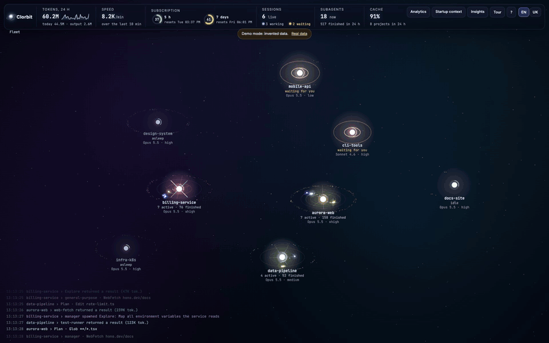
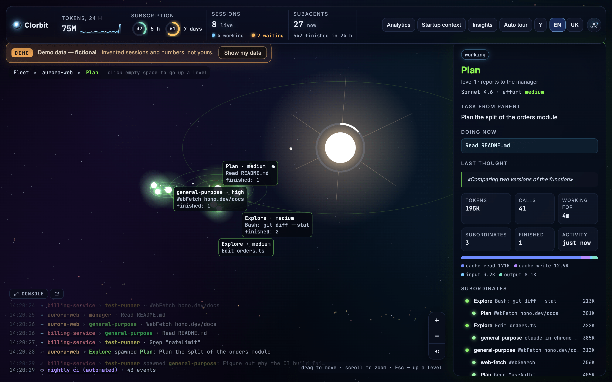
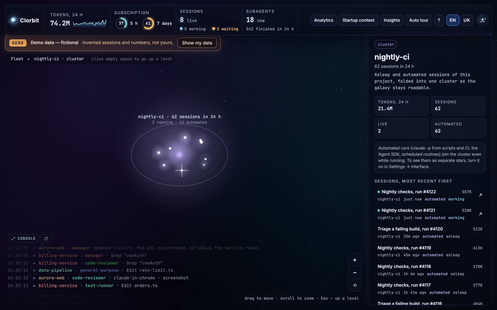
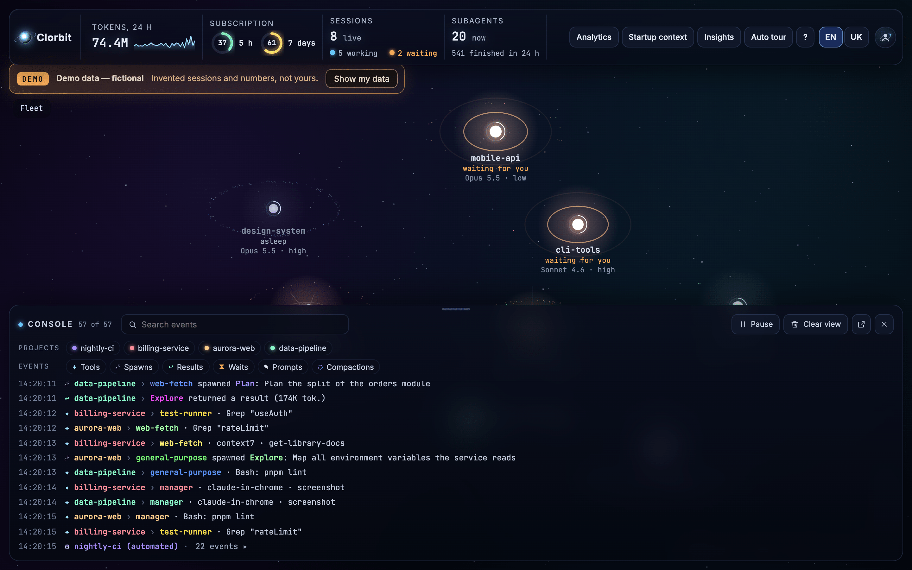
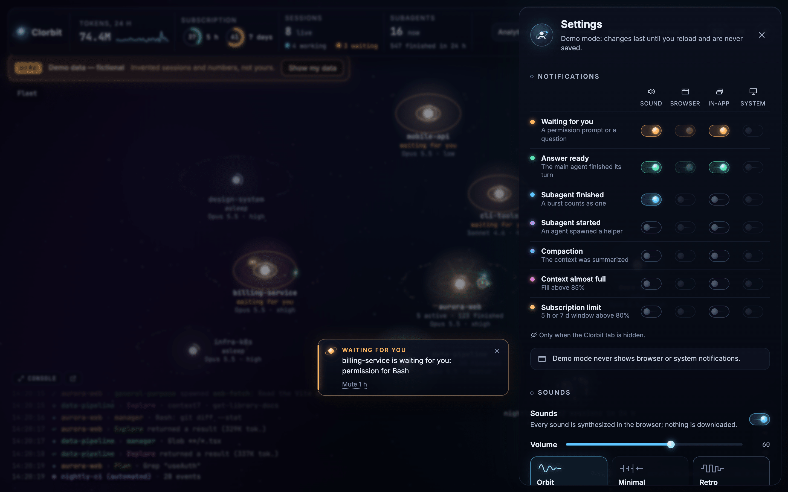
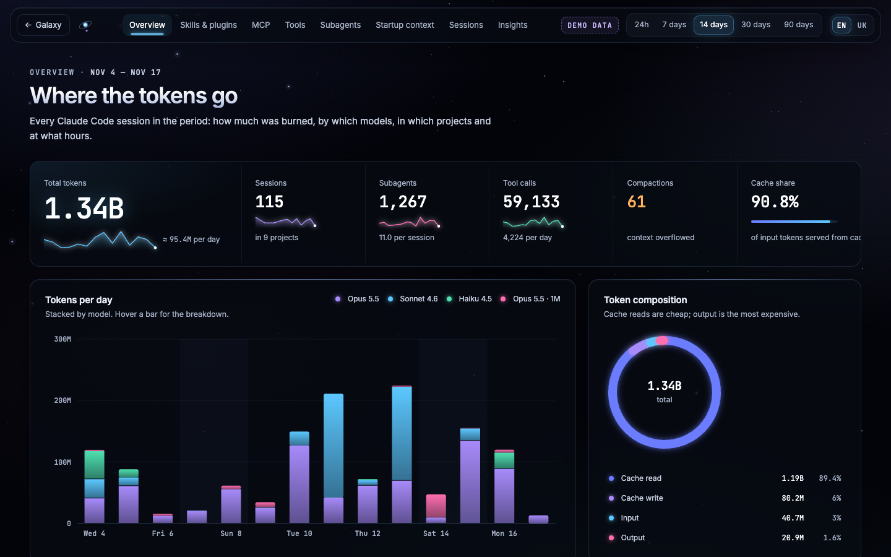
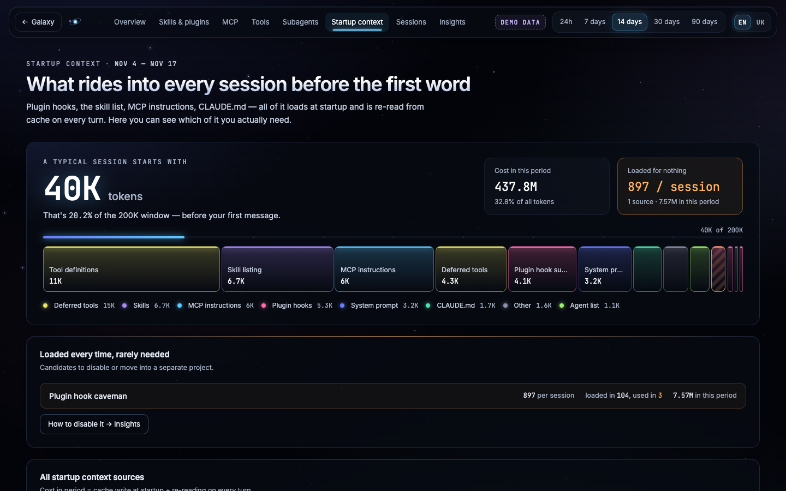
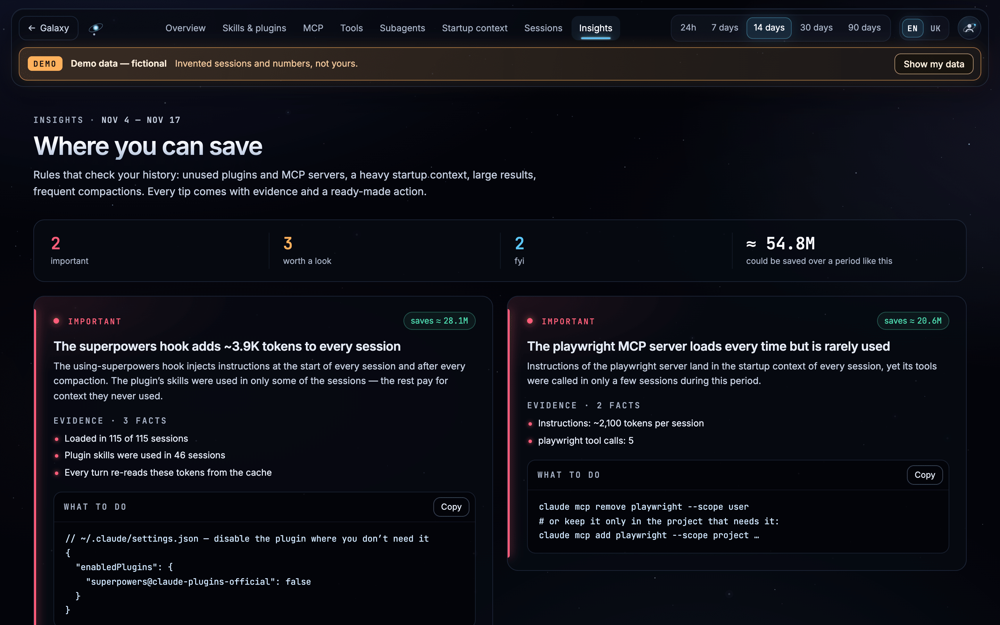

# Clorbit

**Your Claude Code agents, in orbit.**

Clorbit is a local, read-only dashboard for your [Claude Code](https://docs.claude.com/en/docs/claude-code) sessions. Every session is a star, every subagent a planet, and every tool call a flash of light. Next to the galaxy there is a set of analytics pages that show where your tokens go: projects, models, skills, plugins, MCP servers, tools, subagents and the startup context that gets loaded before you type a word.

It runs on your machine, reads the transcripts Claude Code already writes to `~/.claude` (and the Claude desktop app's Cowork sessions, which use the same format), and never sends anything anywhere.



▶ [Watch the 1-minute tour (Ukrainian voiceover)](https://github.com/MaxKarasha/clorbit/releases/download/v0.2.1/clorbit-promo-uk.mp4)

```text
/plugin marketplace add MaxKarasha/clorbit
/plugin install clorbit@clorbit
/clorbit
```

<sub>All screenshots and the animation use the built-in demo mode with invented data. A sharper copy of the animation: [demo.webp](docs/media/demo.webp).</sub>

## Features

<table>
  <tr>
    <td width="50%" valign="top"><a href="docs/media/galaxy.png"></a><br><sub><b>Galaxy.</b> Sessions are stars, subagents planets; flashes for tool calls, comets for new agents.</sub></td>
    <td width="50%" valign="top"><a href="docs/media/galaxy-agent.png"></a><br><sub><b>Agent.</b> The task from its parent, what it is doing now, its latest thought and subordinates.</sub></td>
  </tr>
  <tr>
    <td width="50%" valign="top"><a href="docs/media/cluster.png"></a><br><sub><b>Star cluster.</b> A project's idle and automated sessions folded into one nebula, with their list.</sub></td>
    <td width="50%" valign="top"><a href="docs/media/console.png"></a><br><sub><b>Event console.</b> Tool calls, spawns, results and waits as they happen, with filters and search.</sub></td>
  </tr>
  <tr>
    <td width="50%" valign="top"><a href="docs/media/notifications.png"></a><br><sub><b>Notifications.</b> Events × channels (sound, browser, in-app, system) and a "waiting for you" card.</sub></td>
    <td width="50%" valign="top"><a href="docs/media/analytics.png"></a><br><sub><b>Analytics.</b> Where the tokens go: per day, by model and project.</sub></td>
  </tr>
  <tr>
    <td width="50%" valign="top"><a href="docs/media/context.png"></a><br><sub><b>Startup context.</b> What loads into every session before the first prompt.</sub></td>
    <td width="50%" valign="top"><a href="docs/media/insights.png"></a><br><sub><b>Insights.</b> Advice with evidence and a concrete fix to copy.</sub></td>
  </tr>
</table>

### The galaxy (home page)

- **Stars are sessions.** Size reflects tokens over the last 24 h; the ring around a star is how full its context window is. Dim stars are sessions without a live process that were active in the last day.
- **Planets are subagents**, moons are their subagents (up to three levels). Each branch gets its own color.
- **Star clusters** keep busy projects readable. A project's sessions without a live process fold into one cluster — a few small stars in a soft nebula, sized by tokens, labelled like `product · 137 sessions in 24 h`. Automated runs (`claude -p` from scripts and CI, the Agent SDK, scheduled routines — recognized by Claude Code's `entrypoint`) join the cluster even while running; a dashed ring marks a mostly automated cluster. Click a cluster for its session list (each row opens the session; live ones can be shown as a star). When a project has several stars they sit on a ring that grows with their number, and only the project's main star is labelled until you zoom in or hover. If there would be more than ~24 bodies on screen, the quietest projects fold their idle stars into their clusters (automated runs first); working and waiting sessions always stay visible.
- **Gravity and pins.** Working and waiting sessions slowly drift to the centre (waiting ones closest); finished ones stay where they are, and idle projects only move aside when an active one needs the room (Settings → Interface → Gravity). Drag a star or cluster to pin it in place (double-click, right-click or Alt-click unpins; "Reset layout" in the settings and the zoom controls clears all pins). Pins are saved with your settings.
- **Edge arrows:** zoomed into one system, you still see chips at the screen edge pointing to waiting (orange) and working sessions out of view; click one to fly there.
- **Asteroid belts** hold finished subagents. **Distant stars** on the rim are projects from the last 30 days (click one to open its sessions).
- **Live events:** a flash for every tool call, a comet when an agent is born, a spiral when a result returns to its parent, orange waves when a session is waiting for you.
- **Time machine:** "▶ Replay" (in a session's panel, the cluster list, the Sessions page and the Session page) replays a session in the galaxy from its transcripts — agents are born, work and return, the belt grows and the context ring fills, the console shows what happened with the original times. A timeline at the bottom scrubs through it, with speeds up to 60×, an **auto** speed that squeezes idle gaps, and markers for spawns, waits, compactions and prompts (space, ←/→ and Shift+←/→ work too). Live sessions replay up to now and can follow along.
- **Share a run:** "Export video" in the time machine renders the replay into an **MP4**, **WebM** or **GIF** on your machine (nothing is uploaded): 16:9, 1:1 or 9:16 (Reels / Stories / Threads), the whole session or a selection on the timeline (I / O), 15 / 30 / 60 s or real speed with idle gaps squeezed. A title card, an end card ("Made with Clorbit"), a clock, live counters and captions for spawns, returns and waits are drawn into the frames (each optional). **Anonymize** (on by default) replaces the project with "project", hides the session title, prompts, agent tasks and texts, and cuts tool calls down to tool names. MP4 needs a browser that encodes H.264 with WebCodecs (Chrome, Edge, Safari); GIF works everywhere. A 30-second 1080p MP4 takes about 10–15 s to render.
- **Drill-down levels:** fleet → session (agent tree, tokens, context, effort, current status) → agent (the task from its parent, what it is doing now, its latest thought, its subordinates). Click empty space to go back up.
- **What did this agent change?** The session and agent panels have **Changes** — the files the agent edited or wrote, with +/− lines, edit counts, "new" / "rewritten" and an inline mini-diff per file (failed calls are not counted) — and **Steps**, its recent tool calls and texts with done / error / running, live while it works. The Session page lists the files changed by the whole session.
- **Status bar:** tokens over 24 h with a burn-rate sparkline, tokens per minute, your plan badge and the subscription limits as two gauge bars with a forecast (optional, see below), live sessions, working subagents and cache hit rate. On narrower screens the less important metrics (cache, then speed) give way instead of overlapping.
- An automatic **tour** cycles through the most active systems when you are not interacting (opt-in).
- **Cowork sessions** of the Claude desktop app show up too: each Cowork session runs Claude Code with a config folder of its own, so its tokens, tools and subagents count like any other session's. The star carries the title the app shows and a "Cowork" tag; its project is the folder you gave the session, or *Cowork*. There is no process to watch, so a Cowork session counts as running while it was active in the last 15 minutes (and not archived). The **Cowork** button in the top bar (or Settings → Interface) hides them from the galaxy; analytics keeps counting them. Plain Chat conversations are stored on Anthropic's servers, not on your machine, so they are not shown (they still use the same subscription limits).
- **Event console** in the bottom-left corner: tool calls, spawns, results, waits, prompts and compactions as they happen. Project names take their star's color and agent names their planet's; click either to fly there. Expand it into a docked drawer (resizable, with the last ~500 events from the server, filters by project and event kind, search, pause and "clear view"), or pop it out into its own window (`#/console`) whose clicks drive the galaxy in your main tab.

### Analytics

| Page | What it answers |
| --- | --- |
| Overview | **Top recommendations** (the three biggest savings across all tabs); tokens per day, by model and project; sessions, subagents, tool calls; activity heatmap; subscription-limit history with the forecast to the next reset, and what to do when the week runs out early. |
| Skills & plugins | Which skills and plugins consume tokens (via Claude Code's attribution fields) and how often skills are loaded. A **Recommendations** strip on top points at plugins and skills you have not used for a while, plugin hooks that load context into every session, and duplicate skill names. |
| MCP | Calls and result sizes per MCP server and tool, including servers that are connected but never used. **Recommendations** on top: servers unused for a while (with the right command for where each is configured), servers that keep failing or need sign-in, servers with oversized results, and user-wide servers used in only one or two projects. |
| Tools | Call counts and result sizes for every tool; which ones flood the context. **Recommendations** on top: permission prompts you keep approving (precise allow rules, saving minutes of waiting), files read again and again, huge Bash and tool outputs, tools that often fail. |
| Subagents | Subagent types, their average cost, duration and nesting depth. **Recommendations** on top: read-only agents that could run on a cheaper model, short subagents that mostly pay for their startup context, bursts and deep nesting, agents that often fail. |
| Startup context | What lands in every session before the first prompt: system prompt, tool definitions, skill listing, MCP instructions, CLAUDE.md, plugin hooks. **Recommendations** on top: large CLAUDE.md and rules files, a large auto-memory index, hooks from your settings that print context at every start, and what subagents pay for the startup context again. |
| Sessions | Every session in the range, sortable, filterable by project. **Recommendations** on top: context re-written to the cache after breaks, frequent auto-compactions, a nearly full context, a raised effort on simple prompts, automated runs, days with a low cache hit rate and why. |
| Session | The agent tree, a timeline of prompts, tool calls, spawns and compactions, a context-size chart, and "▶ Replay in galaxy". Recommendations for that session alone. |
| Insights | All recommendations in one place, filterable by tab and sorted by savings: each has evidence, estimated savings and a concrete fix or a ready-made prompt. |

Examples of insights: a plugin whose SessionStart hook adds thousands of tokens to every session, enabled plugins or MCP servers that were never used, tool results over 20K tokens, files read again and again in the same session, auto-compactions, days with a low cache hit rate, noisy or failing hooks, and (with hooks installed) how long agents waited for your permission or reply.

**Recommendations.** Every analytics tab shows the recommendations relevant to it as cards: Skills & plugins, MCP, Startup context, Tools, Subagents and Sessions each have their own; the Overview shows the three biggest savings across all tabs (each card links to its tab); the limits panel says what eats your weekly window and which cards would free the most of it; a session's page shows that session's own issues (compactions, cache rebuilds after breaks, re-read files, huge outputs, subagents on a top model); the Insights page has all of them, filterable by tab, and adds up only savings that do not overlap. A card says what is wrong and why, with the numbers, and how much it would save: context tokens per session and per subagent, an estimate over 30 days and the share of the startup context. Savings are estimates from measured text sizes and your observed number of sessions and subagents. "Unused for a long time" rules look at your whole stored history, archived sessions included; the threshold is in Settings → Recommendations (30 days by default). **Copy prompt** gives you a prompt to paste into a Claude Code session, in two variants: **Ask me** (Claude asks about each item, one at a time, and changes only what you confirm) and **Do it all** (Claude makes every change and shows the result). The prompts name the exact plugins, skills and commands (`claude plugin disable <name>@<marketplace> --scope user`; own skills are moved to `~/.claude/skills-disabled/`, never deleted; MCP servers by where they are configured: `claude mcp remove <name> --scope user|local` for `~/.claude.json`, `disabledMcpjsonServers` in the project's `.claude/settings.local.json` for a `.mcp.json` server, the plugin for a plugin's server, and claude.ai → Settings → Connectors for a connector, which Claude cannot disconnect) and ask Claude to back up every file it edits (settings, `~/.claude.json`, CLAUDE.md, agent files). Permission prompts you keep approving become precise allow rules only for safe-looking commands and tools — never `Bash(*)` or anything that deletes, pushes, installs or downloads. Clorbit itself stays read-only. **Hide** dismisses a card for good (it is saved with your settings and comes back only if its items change); "N hidden · show" brings hidden ones back.

The UI is available in **English** and **Ukrainian** (switch in the top-right corner or in Settings, or add `?lang=uk` to the URL).

### Notifications and sounds

The round profile button at the right end of the top bar (on the galaxy and on every analytics page) opens **Settings**. Everything there is saved by the local server in `~/.clorbit/clorbit.db`, so it survives reloads and applies to every tab.

- **Notifications** — a matrix of events × channels:

  | Event | When |
  | --- | --- |
  | Waiting for you | A session hits a permission prompt or asks a question (once per wait). |
  | Answer ready | The main agent finished its turn (working → idle). |
  | Subagent finished / started | A subagent returned its result / was spawned. A burst of finishes counts as one. |
  | Compaction | The context was compacted. |
  | Context almost full | A session's context crossed 85% (again only after it dropped below 75%). |
  | Subscription limit | The 5-hour or 7-day window crossed 80% (once per window; needs the limits source below). |
  | Limit runs out early | The forecast says the 5-hour window runs out more than 20 min before its reset (once per window, medium confidence or better). On by default: sound + card. |

  Channels: **Sound**, **Browser** notification (asks for permission; can be limited to "only when the Clorbit tab is hidden"), **In-app** card in the corner (click it to fly to the session; "waiting" cards stay until the session moves on; "Mute 1 h" is one click away), and **System** — shown by the Clorbit server itself, so it works even with the tab closed (macOS: `osascript`, Linux: `notify-send` if installed). When System is on for an event, its browser notification is skipped. Defaults: waiting → sound + browser + card; answer ready → sound + card + browser while the tab is hidden; subagent finished → a soft sound; limit runs out early → sound + card; everything else off.
- **Sounds** — synthesized in the browser with Web Audio (no audio files): three themes, *Orbit* (soft bells), *Minimal* (short ticks) and *Retro* (8-bit blips), a distinct sound per event with a preview button, a volume slider and a master switch. "Waiting for you" is the most noticeable sound of each theme. The same sound plays at most once every 1.2 s. Browsers only allow sound after you have clicked the page once.
- **Do not disturb** — a switch and optional daily quiet hours (local time; the window may cross midnight). They silence sounds, browser and system notifications; in-app cards still appear, quietly.
- **Interface** — language, auto tour, **Reduce motion** (slow orbits, no twinkling, instant camera moves), and **Show automated sessions as separate stars** (off by default). While it is off, automated runs stay in their project's cluster, their console events are grouped into one collapsible row per project (`product (automated) · 42 events`), and they never notify — a pipeline that runs `claude -p` a hundred times a day does not ring a hundred times.
- **Connection** — server version, data folder, hooks plugin state, subscription-limits source and event-store counts.

**Open in terminal.** A waiting card, a session's panel in the galaxy and its Session page have an **Open in Warp** (iTerm2, Terminal, …) button that brings the session's own terminal tab to the front, so answering a prompt is one click away. Clorbit finds the terminal from the session's process (its environment, tty and parent app):

| Terminal | What the button does |
| --- | --- |
| Warp | Switches to the session's tab (Warp's own `warp://session/…` link). |
| iTerm2, Terminal | Switches to the tab by its tty (AppleScript; macOS asks once to allow Clorbit — `node` — to control the app). |
| WezTerm | Activates the pane (`wezterm cli activate-pane`). |
| kitty | Focuses the window with `kitten @` when remote control is on (`allow_remote_control` + `listen_on`); otherwise brings kitty to the front. |
| tmux (inside any of these) | Selects the session's pane, then switches the terminal tmux is attached in. |
| Ghostty, Alacritty, VS Code, Cursor, Windsurf, any other app | Brings the app to the front (it can't be told which tab). |

If the detection is wrong — say tmux was started from another terminal — pick the app in **Settings → Terminal** (or hide the button there). The same section lists what was detected for the running sessions. Switching terminals works on macOS; on Linux only through tmux, WezTerm and kitty.

The **browser tab** is a status light too: while sessions wait for you, the favicon gets an orange badge with their number and the title becomes `(2) Waiting for you · Clorbit`, so a pinned or background tab tells you at a glance; a small blue dot means agents are working. It counts the same sessions as the notifications (live ones; automated runs only when they are shown as separate stars).

In demo mode sounds and cards work on the invented data; browser and system notifications never fire and nothing is saved. On macOS the first system notification may ask you to allow notifications for "Script Editor" (that is what `osascript` shows up as).

## Install

Latest release: [v0.2.1](https://github.com/MaxKarasha/clorbit/releases/tag/v0.2.1).

Requirements: **Node.js 22.5+** on your `PATH` (Clorbit uses the built-in `node:sqlite`) and Claude Code. macOS and Linux are supported.

### As a Claude Code plugin (recommended)

Inside Claude Code:

```text
/plugin marketplace add MaxKarasha/clorbit
/plugin install clorbit@clorbit
/clorbit
```

`/clorbit` starts the local server if it is not running and opens the dashboard at <http://127.0.0.1:4980>. **Restart your Claude Code sessions** once after installing: hooks are picked up when a session starts. From then on:

- **Autostart.** When a session starts, the plugin starts the server in the background if it is not already running. The hook is asynchronous and silent: it prints nothing into your session and does not delay it. Set `CLORBIT_AUTOSTART=0` (for example in the `env` block of `~/.claude/settings.json`) to turn it off.
- **Exact live status.** The plugin streams session and agent events (prompts, tool calls, permission requests, subagent starts and stops) to the local server, so "working", "waiting for you" and wait times are exact instead of inferred from transcripts.
- **Nothing to manage.** The event hooks are asynchronous too (`async: true`): Claude Code never waits for them. If Clorbit is not running, `curl` gets "connection refused" within milliseconds and exits silently. Payloads are trimmed before they are stored (no tool input/output bodies, at most 4 KB per event) and kept for 90 days.

Everything the plugin runs ships prebuilt inside it (`plugin/app`): a single-file server and the web app, Node built-ins only, no `npm install` step.

The `/clorbit` command takes an optional argument:

| Command | What it does |
| --- | --- |
| `/clorbit` or `/clorbit open` | Start the server if needed and open the dashboard in your browser. |
| `/clorbit start` | Start the server in the background. |
| `/clorbit stop` | Stop the server that the plugin or the CLI started. |
| `/clorbit status` | Running or not, URL, version, data folder, whether hook events arrive. |
| `/clorbit statusline` | Show how the subscription-limits capture would change your status line (writes nothing). Add `--apply` to write it, `--apply --remove` to undo it, `--apply --create` to make a minimal status line if you have none. See [Subscription limits](#subscription-limits-optional). |

From a shell, the plugin can be managed with `claude plugin enable|disable|uninstall clorbit`. To try it without installing anything: `claude --plugin-dir ./plugin` from a clone.

### Uninstall

```text
/plugin uninstall clorbit@clorbit
/plugin marketplace remove clorbit
```

Run `/clorbit stop` first if you want the server gone right away (otherwise it stops at the next reboot). Clorbit's data stays in `~/.clorbit` (the SQLite database, the server log and pid file); delete that folder to remove it too. Clorbit never writes to `~/.claude`.

### From source

```bash
git clone https://github.com/MaxKarasha/clorbit.git
cd clorbit
pnpm install
pnpm dev          # API server on :4980 + web app with hot reload on :5173
```

Open <http://127.0.0.1:5173>. `pnpm start` builds everything and serves the app from a single server at <http://127.0.0.1:4980>. You can still install the plugin from your clone (`/plugin marketplace add ./path/to/clorbit`) to get the hooks.

If the server is not running, the dashboard says so instead of showing anything: the galaxy and the analytics pages show a "Clorbit server isn't running" screen with how to start it (`/clorbit start` in Claude Code, or `pnpm dev` from source) and a Retry button. The page also checks again every few seconds and comes back on its own once the server is up.

**Demo mode** shows invented sessions and numbers — handy for showing Clorbit to someone without exposing your own projects. It is only ever turned on by you: the "Try the demo" button on the offline screen and on an empty galaxy, or `?demo=1` in the URL (`http://127.0.0.1:5173/#/?demo=1`, or `:4980/#/?demo=1`; `?mock=1` still works). While it is on, every screen carries a "Demo data — fictional" label with a "Show my data" button that leaves it; the mode stays on while you move between the galaxy and the analytics pages.

The first start scans your history in `~/.claude/projects` in the background (a few seconds even for gigabytes of transcripts); live sessions show up immediately. Summaries are stored in `~/.clorbit/clorbit.db`, so later starts take a fraction of a second and only read what is new.

### Command line

The plugin's `/clorbit` command is a thin wrapper around a small CLI (`plugin/app/cli.mjs`, plain Node, no dependencies). From a clone you can run it directly:

```bash
node plugin/app/cli.mjs            # same as `open`
node plugin/app/cli.mjs start      # start in the background, wait until it answers
node plugin/app/cli.mjs status
node plugin/app/cli.mjs stop
node plugin/app/cli.mjs statusline # dry run of the status-line capture (--apply, --remove, --create)
pnpm clorbit status                # the same through pnpm
```

The server runs detached with its pid file and log in `~/.clorbit` (`clorbit.pid`, `clorbit.log`). `stop` only stops a server the CLI started; a `pnpm dev` server is left alone. If the port is taken by another program, `start` and `status` say so; pick another port with `CLORBIT_PORT`.

### Subscription limits (optional)

Your 5-hour and 7-day subscription usage only exists in the JSON that Claude Code pipes into your **status-line command**. To show it, the status-line command has to save its input to `~/.clorbit/statusline.json` before doing whatever it did before. Clorbit can make that one-line change for you — after showing it to you. With the plugin, in Claude Code:

```text
/clorbit statusline                  # dry run: prints the exact change, writes nothing
/clorbit statusline --apply          # applies it, with a timestamped backup of settings.json
/clorbit statusline --apply --remove # undoes it: restores your original command
```

No status line yet? `/clorbit statusline --apply --create` makes a minimal one (the model and both limits, e.g. `Opus · 5h 42% · 7d 18%`; it needs Node.js on your PATH) that also saves the input. From a clone of the repository the same change is `node scripts/install-hooks.mjs --apply --statusline` (dry run without `--apply`).

Both only touch `statusLine.command` in `~/.claude/settings.json` (or add `statusLine` with `--create`), keep a backup next to it, and pass the input to your original command unchanged; running it again is a no-op. Clorbit never runs them by itself; Settings → Connection shows the commands with copy buttons. Clorbit polls the file every 30 s and records a history of changes (`GET /api/limits/history`).

**Plan and windows.** The status bar shows your plan as a badge (e.g. «Max · 20×»), read from `~/.claude.json` — only the plan fields of the signed-in account (`planDisplayName`, organization type, rate-limit tier, subscription date); the recommendations also read the names of configured MCP servers from it (never their commands, URLs or secrets), nothing else. Each window is a bar: the fill is the used %, the hatched stretch and marker show the projected % at the reset. Plans with only a weekly limit (Ultra) show the 5-hour bar as **∞**: Clorbit sees it in the status-line data (the 7-day window is reported, the 5-hour one is not), or, before the first reading, from a small plan table; the data always wins and a 5-hour window that comes back is picked up automatically.

**Forecast.** From that history Clorbit estimates when each window runs out (`GET /api/limits/forecast`): a regression over the current window that weighs recent minutes most (half-life 30 min for 5 h, 2 days for 7 d), started afresh at every reset. While a window has only a couple of points, your transcript token rate (output weighted ×5, cache reads ×0.1) is calibrated against the % those points gained. A reading older than 20 min (5 h) is projected from now, since the status line only writes while Claude Code runs. The bar's marker is the projected % at the reset; the tooltip shows the rate, confidence and basis. Usage outside Claude Code on this machine (claude.ai, other computers) moves the limits but not the token proxy, so the forecast adapts only as new readings arrive.

## Privacy and safety

- **Localhost only.** The server binds to `127.0.0.1`; nothing is exposed to your network and nothing is sent to the internet. The only external request the web page makes is for Google Fonts. Settings can only be changed from a local page (other origins get 403).
- **Open in terminal** runs only when you click it, and only for a live Claude Code session: Clorbit reads a few variables of that process's environment (`TERM_PROGRAM`, `WARP_FOCUS_URL`, `TMUX`, …) and its tty, validates them, and runs `open`, `osascript`, `tmux`, `wezterm` or `kitten` with an argument list (no shell). It never types into a terminal.
- **System notifications** are shown with `osascript` (macOS) or `notify-send` (Linux), started with an argument list (no shell), rate-limited, and only for the events you switch on.
- **Read-only over `~/.claude`.** Clorbit never writes to `~/.claude`. The Claude desktop app's Cowork folder is read-only too: besides the transcripts, only the title, the first chosen folder and the archived flag are read from each session's metadata file (which also holds your e-mail and the system prompt). The only exception is the status-line capture (`/clorbit statusline`, or `scripts/install-hooks.mjs`), and only when you run it with `--apply` yourself.
- **Your data stays in `~/.clorbit`.** That folder holds the SQLite database (`clorbit.db`, including your settings), the server's log and pid file when it was started by the plugin or the CLI, and the optional status-line capture. Delete it at any time; it will be rebuilt from your transcripts (except history of transcripts Claude Code has already deleted).
- **Archived history.** Claude Code deletes transcripts older than 30 days by default. Clorbit keeps their summaries and marks them as archived, so analytics and insights still include that history. An archived session keeps its summary, agent tree, startup context and tools, but has no timeline or context chart.
- **Demo mode** (`?demo=1`) uses invented data only — safe for screenshots and screen sharing. Clorbit never switches to it by itself: when the server is down you see an "isn't running" screen, not made-up numbers.

See [SECURITY.md](SECURITY.md) for the threat model and how to report a vulnerability.

## Configuration

All settings are environment variables. The old `FLEET_*` names are still read as fallbacks.

| Variable | Default | Purpose |
| --- | --- | --- |
| `CLORBIT_PORT` | `4980` | Server port. The dev proxy, the CLI and the plugin's hooks follow it. |
| `CLORBIT_DATA_DIR` | `~/.clorbit` | Where `clorbit.db` lives. |
| `CLORBIT_URL` | `http://127.0.0.1:$CLORBIT_PORT` | Where the plugin's hooks send events. |
| `CLORBIT_AUTOSTART` | — | Set to `0` to stop the plugin from starting the server when a session starts. |
| `CLORBIT_CLAUDE_DIR` | `~/.claude` | Claude Code's data folder to read (and where `clorbit statusline` finds `settings.json`). |
| `CLORBIT_CLAUDE_JSON` | `~/.claude.json` | Claude Code's account file; only the plan fields and the names of configured MCP servers are read. With `CLORBIT_CLAUDE_DIR` set, a `.claude.json` inside it or next to it. |
| `CLORBIT_COWORK_DIR` | `~/Library/Application Support/Claude/local-agent-mode-sessions` (macOS), `~/.config/Claude/local-agent-mode-sessions` (Linux) | The Claude desktop app's Cowork sessions. `off` stops reading them. |
| `CLORBIT_STATUSLINE_FILE` | `~/.clorbit/statusline.json` | Status-line capture file. |
| `CLORBIT_SERVE_WEB` | on in the built server | Serve the web app from the API server. The built server (`plugin/app/server.mjs`) does by default; under `pnpm dev`/`pnpm server` set it to `1` after `pnpm build`. |

Upgrading from a pre-release that stored its database in `<repo>/data/fleet.db`: on first start Clorbit copies it to `~/.clorbit/clorbit.db` once and logs it. The copy only happens for the default data folder: with `CLORBIT_DATA_DIR` set, a new folder starts empty. A status-line capture at `~/.fleet/statusline.json` is still read if the new file does not exist.

## How the numbers are computed

- **Tokens** come from `message.usage` of every assistant record in the transcripts: input, output, cache read and cache write. Claude Code writes several records per API call (one per content block), so usage is **deduplicated by `requestId`** (falling back to `message.id`). Synthetic messages are ignored.
- **Totals** are the sum of all four fields. That is not a bill — cache reads are much cheaper than input — but it is a good measure of how much context flows through your sessions and how fast you approach subscription limits.
- **Subagents** are counted from their own transcripts (`<session>/subagents/agent-*.jsonl`), so a session's total includes everything its agents did.
- **Attribution** to skills, plugins and MCP servers uses the `attributionSkill`, `attributionPlugin` and `attributionMcpServer` fields that Claude Code writes on assistant records. Turns without them count as regular work.
- **Startup context and tool result sizes are estimates**: characters ÷ 3.6. Transcripts do not record token counts for these parts.
- **Recommendation savings are estimates** too: a plugin's or skill's share of the skill listing (plus its SessionStart hook block and MCP instructions) per session and per subagent, from the last 30 days; "over 30 days" is what that context cost in the sessions and subagents of those 30 days (a shorter history is scaled up). Cards about the selected period say so and use the period instead. An MCP server costs its instructions plus its tool list: with tool search on, only tool names are listed at the start (schemas load when a tool is used), so that is what is counted; full definitions are counted only when the transcript shows them. Compressing a CLAUDE.md or a memory index is assumed to cut about 40% of it — a rough estimate, labelled as one. Waiting time for permission prompts comes from hook events (from a prompt to the tool's result, minus the call's usual run time). A cheaper subagent model saves a share of that agent's cost from relative API prices (Opus 5.5 → Sonnet 5.5 ≈ −50%), shown as tokens' worth; subscription limits weigh models too, but by an unpublished formula. Cache rebuilt after a break is measured: the cache writes of turns that followed an idle gap and re-wrote most of the context, minus the startup context a fresh session writes anyway. On the limits panel, other cards' savings become a share of the window: their tokens weighted like limits roughly count them (context as cache writes, a cheaper model at the window's average mix) against the window's weighted use so far, applied to the projected use at the reset — a rough estimate, labelled as one, and never added to the Insights total.
- **Context fill** is `input + cache read + cache write` of the main agent's latest turn, against 200K or 1M depending on the model.
- **Days and hours** are in your local time zone.

## Limitations

- Without the hooks plugin, "waiting for permission" is a guess: a long-running Bash command can look the same.
- Startup context and tool result sizes are estimates (see above).
- The first open of a very large session (hundreds of subagents) can take a few seconds; after that it is cached. The same goes for its replay; replays of very long sessions sample tool calls (every spawn, return, prompt, wait and compaction is kept).
- Replays of archived sessions (transcripts already cleaned up by Claude Code) show only their structure: agents, their lifetimes and hourly tokens.
- The "24 h" preset in analytics means yesterday + today, because the analytics API works with dates.
- Live updates rely on `fs.watch` with a polling fallback; on unusual file systems updates may lag by a few seconds.
- Clorbit reads the transcript format of current Claude Code versions; a future format change may need an update.
- The Cowork folder layout is not documented by Anthropic; if the desktop app changes it, Cowork sessions simply stop showing up until Clorbit is updated. Their status comes from the transcript alone (there is no process or hook to ask), so "waiting for you" is not detected for them.

## Roadmap

- `npx clorbit` for running without a clone or the plugin.
- Cost estimates per model, using public pricing.
- Export of analytics (CSV/JSON).
- More insights (e.g. model choice per task type, idle subagents).
- Windows support.

Ideas and pull requests are welcome — see [CONTRIBUTING.md](CONTRIBUTING.md).

## Development

```bash
pnpm dev          # server (tsx watch) + Vite dev server
pnpm typecheck    # TypeScript, no emit
pnpm test         # Vitest (server tests on synthetic transcripts)
pnpm build        # web app → plugin/app/web, server bundle → plugin/app/server.mjs
```

The build output in `plugin/app` is committed, because Claude Code installs the plugin straight from the repository. The build is deterministic; CI rebuilds it and fails if `plugin/` differs from what is committed, so run `pnpm build` and commit `plugin/` together with your source changes. The version lives in `package.json`; `pnpm build` copies it into `plugin/.claude-plugin/plugin.json`.

The project layout and the data flow are described in [docs/ARCHITECTURE.md](docs/ARCHITECTURE.md). The API contract between the server and the web app is [`shared/api.ts`](shared/api.ts).

## Contributing

Bug reports, ideas and pull requests are welcome. Please read [CONTRIBUTING.md](CONTRIBUTING.md) first; for security issues use [SECURITY.md](SECURITY.md) instead of a public issue.

## License

[MIT](LICENSE) © 2026 Maksym Karasha

Clorbit is an independent project and is not affiliated with or endorsed by Anthropic. "Claude" and "Claude Code" are trademarks of Anthropic.
