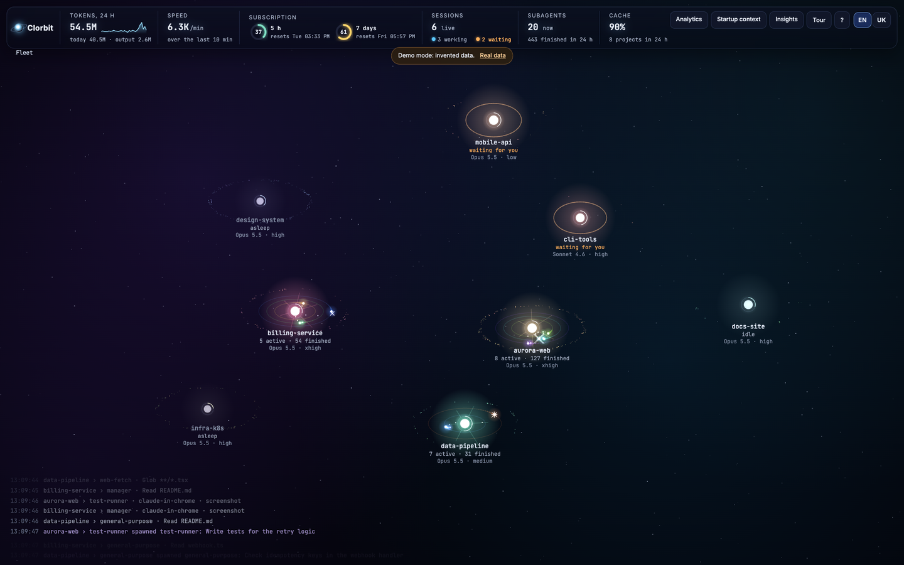

# Clorbit

**Your Claude Code agents, in orbit.**

Clorbit is a local, read-only dashboard for your [Claude Code](https://docs.claude.com/en/docs/claude-code) sessions. Every session is a star, every subagent a planet, and every tool call a flash of light. Next to the galaxy there is a set of analytics pages that show where your tokens go: projects, models, skills, plugins, MCP servers, tools, subagents and the startup context that gets loaded before you type a word.

It runs on your machine, reads the transcripts Claude Code already writes to `~/.claude`, and never sends anything anywhere.




## Features

### The galaxy (home page)

- **Stars are sessions.** Size reflects tokens over the last 24 h; the ring around a star is how full its context window is. Dim stars are sessions without a live process that were active in the last day.
- **Planets are subagents**, moons are their subagents (up to three levels). Each branch gets its own color.
- **Asteroid belts** hold finished subagents. **Distant stars** on the rim are projects from the last 30 days (click one to open its sessions).
- **Live events:** a flash for every tool call, a comet when an agent is born, a spiral when a result returns to its parent, orange waves when a session is waiting for you.
- **Drill-down levels:** fleet → session (agent tree, tokens, context, effort, current status) → agent (the task from its parent, what it is doing now, its latest thought, its subordinates). Click empty space to go back up.
- **Status bar:** tokens over 24 h with a burn-rate sparkline, tokens per minute, subscription limits (optional, see below), live sessions, working subagents and cache hit rate.
- An automatic **tour** cycles through the most active systems when you are not interacting.

### Analytics

| Page | What it answers |
| --- | --- |
| Overview | Tokens per day, by model and project; sessions, subagents, tool calls; activity heatmap. |
| Skills & plugins | Which skills and plugins consume tokens (via Claude Code's attribution fields) and how often skills are loaded. |
| MCP | Calls and result sizes per MCP server and tool, including servers that are connected but never used. |
| Tools | Call counts and result sizes for every tool; which ones flood the context. |
| Subagents | Subagent types, their average cost, duration and nesting depth. |
| Startup context | What lands in every session before the first prompt: system prompt, tool definitions, skill listing, MCP instructions, CLAUDE.md, plugin hooks. |
| Sessions | Every session in the range, sortable, filterable by project. |
| Session | The agent tree, a timeline of prompts, tool calls, spawns and compactions, and a context-size chart. |
| Insights | Rules that turn the numbers into advice: each insight has evidence and a concrete fix (often a config snippet to copy). |

Examples of insights: a plugin whose SessionStart hook adds thousands of tokens to every session, enabled plugins or MCP servers that were never used, tool results over 20K tokens, files read again and again in the same session, auto-compactions, days with a low cache hit rate, noisy or failing hooks, and (with hooks installed) how long agents waited for your permission or reply.

The UI is available in **English** and **Ukrainian** (switch in the top-right corner, or add `?lang=uk` to the URL).

## Quick start

Requirements: **Node.js 22.5+** (for the built-in `node:sqlite`) and **pnpm**. macOS and Linux are supported.

```bash
git clone https://github.com/MaxKarasha/clorbit.git
cd clorbit
pnpm install
pnpm dev          # API server on :4980 + web app on :5173
```

Open <http://127.0.0.1:5173>.

- `pnpm start` builds the web app and serves everything from a single server at <http://127.0.0.1:4980>.
- `http://127.0.0.1:5173/#/?mock=1` is a demo mode with invented data — handy for showing Clorbit to someone without exposing your own projects.

The first start scans your history in `~/.claude/projects` in the background (a few seconds even for gigabytes of transcripts); live sessions show up immediately. Summaries are stored in `~/.clorbit/clorbit.db`, so later starts take a fraction of a second and only read what is new.

### Hooks plugin (recommended)

Without hooks, Clorbit infers "waiting for permission" from the transcripts, which is a heuristic. The `clorbit` Claude Code plugin streams session and agent events to the local server so statuses are exact and waits can be measured.

Inside Claude Code:

```text
/plugin marketplace add MaxKarasha/clorbit
/plugin install clorbit@clorbit
```

Or from a shell:

```bash
claude plugin marketplace add MaxKarasha/clorbit
claude plugin install clorbit@clorbit
claude plugin disable clorbit     # turn it off
claude plugin enable clorbit      # turn it back on
claude plugin uninstall clorbit   # remove it
```

Sessions pick up the change after a restart. To try it without installing: `claude --plugin-dir ./plugin`.

How it behaves:

- The hooks are **asynchronous** (`async: true`): Claude Code does not wait for them, so they cannot slow your sessions down.
- If Clorbit is not running, `curl` gets "connection refused" within milliseconds and exits silently. There is no need to add and remove hooks when you start or stop the dashboard.
- Payloads are trimmed before they are stored (no tool input/output bodies, at most 4 KB per event) and kept for 90 days.

> **Coming in v0.2:** a one-command plugin flow — slash commands to open the dashboard and autostart of the server from the plugin. Today the plugin only ships the hooks; you start the server yourself with `pnpm dev` or `pnpm start`.

### Subscription limits (optional)

Your 5-hour and 7-day subscription usage only exists in the JSON that Claude Code pipes into your **status-line command**. To show it, the status-line command has to save its input to `~/.clorbit/statusline.json` before doing whatever it did before. Clorbit can make that one-line change for you — after showing it to you:

```bash
node scripts/install-hooks.mjs                         # dry run: prints the change, writes nothing
node scripts/install-hooks.mjs --apply --statusline    # applies it, with a timestamped backup of settings.json
```

The script only touches `statusLine.command` in `~/.claude/settings.json`, keeps a backup next to it, and passes the input to your original command unchanged. You need an existing status line of type `command`. Clorbit polls the file every 30 s and records a history of changes (`GET /api/limits/history`).

## Privacy and safety

- **Localhost only.** The server binds to `127.0.0.1`; nothing is exposed to your network and nothing is sent to the internet. The only external request the web page makes is for Google Fonts.
- **Read-only over `~/.claude`.** Clorbit never writes to `~/.claude`. The only exception is `scripts/install-hooks.mjs`, and only when you run it with `--apply` yourself.
- **Your data stays in `~/.clorbit`.** That folder holds the SQLite database (`clorbit.db`) and the optional status-line capture. Delete it at any time; it will be rebuilt from your transcripts (except history of transcripts Claude Code has already deleted).
- **Archived history.** Claude Code deletes transcripts older than 30 days by default. Clorbit keeps their summaries and marks them as archived, so analytics and insights still include that history. An archived session keeps its summary, agent tree, startup context and tools, but has no timeline or context chart.
- **Demo mode** (`?mock=1`) uses invented data only — safe for screenshots and screen sharing.

See [SECURITY.md](SECURITY.md) for the threat model and how to report a vulnerability.

## Configuration

All settings are environment variables. The old `FLEET_*` names are still read as fallbacks.

| Variable | Default | Purpose |
| --- | --- | --- |
| `CLORBIT_PORT` | `4980` | API server port (the dev proxy follows it). |
| `CLORBIT_DATA_DIR` | `~/.clorbit` | Where `clorbit.db` lives. |
| `CLORBIT_URL` | `http://127.0.0.1:4980` | Where the plugin's hooks send events. |
| `CLORBIT_CLAUDE_DIR` | `~/.claude` | Claude Code's data folder to read. |
| `CLORBIT_STATUSLINE_FILE` | `~/.clorbit/statusline.json` | Status-line capture file. |
| `CLORBIT_SERVE_WEB` | — | Set to `1` to serve the built web app from the API server (`pnpm start` does this). |

Upgrading from a pre-release that stored its database in `<repo>/data/fleet.db`: on first start Clorbit copies it to `~/.clorbit/clorbit.db` once and logs it. A status-line capture at `~/.fleet/statusline.json` is still read if the new file does not exist.

## How the numbers are computed

- **Tokens** come from `message.usage` of every assistant record in the transcripts: input, output, cache read and cache write. Claude Code writes several records per API call (one per content block), so usage is **deduplicated by `requestId`** (falling back to `message.id`). Synthetic messages are ignored.
- **Totals** are the sum of all four fields. That is not a bill — cache reads are much cheaper than input — but it is a good measure of how much context flows through your sessions and how fast you approach subscription limits.
- **Subagents** are counted from their own transcripts (`<session>/subagents/agent-*.jsonl`), so a session's total includes everything its agents did.
- **Attribution** to skills, plugins and MCP servers uses the `attributionSkill`, `attributionPlugin` and `attributionMcpServer` fields that Claude Code writes on assistant records. Turns without them count as regular work.
- **Startup context and tool result sizes are estimates**: characters ÷ 3.6. Transcripts do not record token counts for these parts.
- **Context fill** is `input + cache read + cache write` of the main agent's latest turn, against 200K or 1M depending on the model.
- **Days and hours** are in your local time zone.

## Limitations

- Without the hooks plugin, "waiting for permission" is a guess: a long-running Bash command can look the same.
- Startup context and tool result sizes are estimates (see above).
- The first open of a very large session (hundreds of subagents) can take a few seconds; after that it is cached.
- The "24 h" preset in analytics means yesterday + today, because the analytics API works with dates.
- Live updates rely on `fs.watch` with a polling fallback; on unusual file systems updates may lag by a few seconds.
- Clorbit reads the transcript format of current Claude Code versions; a future format change may need an update.

## Roadmap

- v0.2: one-command plugin flow (slash commands, server autostart from the plugin).
- Cost estimates per model, using public pricing.
- Export of analytics (CSV/JSON).
- More insights (e.g. model choice per task type, idle subagents).
- Windows support.

Ideas and pull requests are welcome — see [CONTRIBUTING.md](CONTRIBUTING.md).

## Development

```bash
pnpm dev          # server (tsx watch) + Vite dev server
pnpm typecheck    # TypeScript, no emit
pnpm test         # Vitest (server tests on synthetic transcripts)
pnpm build        # production build of the web app into dist/
```

The project layout and the data flow are described in [docs/ARCHITECTURE.md](docs/ARCHITECTURE.md). The API contract between the server and the web app is [`shared/api.ts`](shared/api.ts).

## Contributing

Bug reports, ideas and pull requests are welcome. Please read [CONTRIBUTING.md](CONTRIBUTING.md) first; for security issues use [SECURITY.md](SECURITY.md) instead of a public issue.

## License

[MIT](LICENSE) © 2026 Maksym Karasha

Clorbit is an independent project and is not affiliated with or endorsed by Anthropic. "Claude" and "Claude Code" are trademarks of Anthropic.
